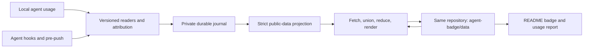

# Repository-native agent-badge: breaking redesign

Status: approved and implemented through Tasks 1–18 on the refactor branch. Task 17 performance/legacy removal has passed independent review; its measured latency exception is recorded in §14. Tasks 1–18 and their task reviews are complete. The final whole-branch review found three Important and four Minor issues; the single combined fix wave is under validation and its scoped re-review remains pending; see [candidate verification](../../maintainers/RELEASE-VERIFICATION.md). No replacement release or deployment has occurred. Hosted GitHub policy, Linux/Windows and authenticated private-image gates remain unverified.
Research date: 2026-10-22. Baseline: `d209a47` / npm packages `1.1.20`.
Working branch: `refactor/repo-native-agent-badge`.

Read alongside the [audit](../research/2026-10-22-repo-audit.md) and
[implementation plan](../plans/2026-10-22-repo-native-refactor.md).

## 1. Product decision

Install agent-badge in a repository once. It records supported local agent usage,
keeps a durable privacy-filtered ledger in the same Git repository, and updates a
README badge automatically through normal Git credentials. No Gist, service
account, hosted backend, globally installed runtime, or Shields dependency.

The badge measures **all recorded AI usage attributed to this repository**, across
contributors, machines, worktrees, and code branches. Rebase, squash, revert,
cherry-pick, and deleting a code branch do not change the total. Abandoned work
still consumed resources. It is not a measure of merged code, human productivity,
AI-authored lines, or an invoice. Coverage is explicitly partial when a source is
unavailable or cannot be interpreted safely.

The user requested a comprehensive breaking refactor, delegated the storage choice,
and asked for the simplest metric to maintain with minimum risk. The architecture was approved for implementation; its source-specific capability limits are documented in the current provider contracts.

## 2. Storage alternatives and recommendation

| Option | Advantages | Operational costs and failure modes | Decision |
| --- | --- | --- | --- |
| Aggregate JSON and SVG on each code branch | Visible with code; simple first prototype; GitHub can display relative images | One shared mutable total produces merge conflicts and lost updates; automatic staging/commits interfere with user work; pre-push edits cannot change the commits already selected for that push | Reject as the default |
| Immutable usage receipts on code branches; CI aggregates | Auditable; fork PRs can carry receipts; no shared total conflict | Receipt churn in ordinary commits; collection must happen before commit or require extra commits; abandoned/uncommitted work is missed; rebases/squashes require stable usage identities anyway | Use only for explicit fork contribution envelopes |
| Dedicated data branch in the same repository | Same ownership, access control, backup, and Git history; no feature-branch churn; no extra service; all-work semantics independent of code history | Requires a small synchronization engine, an additional branch, and permission to update it; generated images have hosting caches; branch rules need diagnosis | **Recommended default** |
| Git notes | Separates metadata from files | Notes need extra fetch/push configuration, do not naturally follow rewritten commits, and cannot directly serve a README image | Reject |
| Actions artifacts/cache | No commits for every refresh | Retention/expiry and download authentication; not a durable public badge endpoint; CI cannot inspect unsubmitted local usage | Reject as source of truth |
| GitHub Pages | Good presentation hosting | Extra deployment configuration/permissions, public/private hosting implications, publication delay; still needs a durable ledger and local collection | Optional future presentation only |
| Releases/assets, repository variables, issues | Uses GitHub infrastructure | Adds API ownership, limits, race handling, or inappropriate user-facing objects without improving the accounting model | Reject |
| Gist or external service | Familiar rendering pipeline | Separate ownership, credentials, lifecycle, synchronization, and recovery; conflicts with the requested ownership model | Remove |

Choose an orphan branch `agent-badge/data`. It contains regular JSON and SVG files
that can be inspected in GitHub and cloned with the repository. Do not create a
checked-out worktree for it or alter the user's current branch. Use a private Git
index and Git plumbing to construct data commits.

This is a little more transport code than committing a JSON total, but substantially
less ongoing work for users. The implementation is deliberately a single-ref,
fast-forward transaction. Do not introduce per-contributor branches, a daemon,
distributed service discovery, or a new database server.



## 3. Scope and honest automation boundary

The initial release supports automatic collection and synchronization for
contributors with permission to push the repository's data branch. A fresh clone
needs one local activation, because Git does not install executable hooks from a
clone and agents require trust for project hooks. Document this directly:

```sh
# Repository owner: install, configure, backfill, and enable this checkout
npm init agent-badge@latest

# Another contributor or a fresh clone: activate the committed setup
node .agent-badge/run.cjs setup
```

The second command installs the pinned runtime if needed, registers local source
roots and hooks, and resumes any queue. It does not create another badge or ledger.
Where a team already has an explicit bootstrap/devcontainer task, wire this command
into that task. Do not silently modify root package lifecycle scripts or system-wide
Git/agent configuration to simulate universal installation.

Agent lifecycle hooks perform targeted collection when supported and trusted.
`pre-push` is a universal local catch-up and synchronization opportunity. A session
ending after the final push remains pending until another supported hook or manual
`sync`; no daemon means there is no guarantee of immediate updates while the machine
is idle. Hooks that agents decline to run remain visible in `doctor`.

Remote development, containers, and CI collect where the agent runs. They use the
same normalization and ledger protocol. A laptop cannot discover cloud-only usage.

## 4. Files and ownership

```text
Code branches (committed once, changed only for configuration/upgrades)
  .agent-badge/config.json         repository ID, policy, transport, presentation
  .agent-badge/run.cjs             small versioned launcher
  .agent-badge/runtime/package.json
  .agent-badge/runtime/package-lock.json
  .agent-badge/README.md           activation, data-branch link, coverage meaning
  README.md                       one managed badge block
  provider hook configuration     narrowly owned entries, only when enabled

Data branch: refs/heads/agent-badge/data
  meta.json                       ledger protocol, repo ID, normalization/catalog versions
  observations/ab/<digest>.json    immutable sanitized observation objects
  controls/ab/<digest>.json        explicit exclusions/corrections, no free-form notes
  catalog.json                    exact versioned rate cards used for derived costs
  summary.json                    deterministic totals, coverage, ledger input hash
  badge.svg                       locally rendered, deterministic safe SVG
  README.md                       aggregate report and self-reported-data explanation

Private local state: <git-common-dir>/agent-badge/
  local.json                      explicit local provider roots and runtime resolution
  runtime/<lock-hash>/             installed pinned runtime, shared by worktrees
  journal/                        durable normalized observations and pending outbox
  checkpoints/                    parser cursors and source fingerprints
  cache/                          disposable indexes and downloaded ref state
  locks/                          bounded operation locks
  logs/                           bounded redacted diagnostics
```

No credentials, raw provider IDs, source paths, transcripts, or agent-work filenames
in tracked files or data commits. Provider-local logs remain the source for backfill;
the sanitized ledger becomes the durable record of usage already observed, so
provider retention and a lost laptop do not erase published history. Unsubmitted
observations survive checkpoint/cache rebuilds, but cannot survive loss of the only
machine holding them. `doctor` distinguishes these stores.

The private store is shared by linked worktrees through `git --git-common-dir`.
Checkpoints include provider instance, actual source identity, parser version,
normalization version, repository ID, and attribution-policy hash. Worktree-specific
hook/context metadata is keyed separately. Git operations resolve the effective
index and directories; never assume `.git` is a directory.

### Configuration authority

`meta.json` on the data branch is authoritative for shared policy, schema and
normalization versions, badge settings, and pricing catalog hash. The committed
code-branch config declares repository identity, installation/runtime requirements,
the intended transport target, and a bootstrap copy of policy. After initialization,
ordinary collection/sync never promotes a code branch's policy into ledger metadata.
Stale code branches therefore cannot roll back the badge, catalog, or exclusions.

An explicit `configure --from-file <path>` command validates a requested policy,
fetches the current metadata revision, and proposes an atomic data transaction. A
concurrent policy edit causes a conflict requiring review, not automatic overwrite.
It also updates the checkout's declaration for the user to commit; if that local
write fails after remote acceptance, `status` reports the drift and `setup` repairs
the declaration. Runtime/protocol upgrades follow the same explicit metadata path.
Initial creation is allowed only by `init`; a missing previously seen data branch
is a recovery condition. Config read from an old branch cannot redirect the activated
checkout's locally recorded remote binding.

## 5. Repository identity and attribution

Create a random repository UUID in committed configuration. Scope public usage
digests to that UUID. A remote URL is routing/context, not accounting identity;
renames and SSH/HTTPS URL changes must not duplicate usage. Different checkouts of
the same repository share the UUID. Detect accidental UUID reuse against the data
branch before sending anything.

Attribution order:

1. Explicit per-unit user exclusion/inclusion.
2. Verified Git common-directory/worktree membership for the observed execution cwd.
3. Exact recorded repository remote matched against configured canonical aliases.
4. Stored, previously verified local mappings for worktrees that were removed.
5. Weak evidence becomes ambiguous and remains uncounted.

Resolve the nearest enclosing Git repository for nested cwd values; a submodule or
nested independent repository does not belong to its parent merely by path prefix.
An existing strong contradictory repository identity prevents remote-alias matching
from counting the same work twice. Do not crawl prompt text looking for repository
names. Multi-repository sessions are split only where trustworthy per-request
execution context exists; otherwise mark their affected usage ambiguous. A terminal
command mentioning another repo is not evidence that all tokens belong there.

Code branch names and Git authors are not usage identities. Contributor identities
are not required for totals. A session copied to another machine retains its usage
identity. Forked/resumed agent conversations require provider-specific lineage rules,
which are distinct from Git branch handling.

## 6. Accounting model

Use stable **accounting units**, not publisher totals or scan-time deltas. Prefer
provider request/response identities with usage metadata; a validated cumulative
stream is a fallback only when its boundaries and inherited history are known.

Private `UsageObservation` contains provider, native accounting identity, execution
context, source revision/evidence, lineage, model segments, token dimensions, and
adapter diagnostics. Before any Git object is created, `sanitizeObservation` emits
a strict `PublicObservation` allowlist:

```ts
type PublicObservation = {
  schemaVersion: 2;
  repositoryId: string;                  // UUID
  normalizationVersion: 1;
  unitKey: string;                       // repo-scoped digest
  coverageKey: string;                   // repo-scoped digest of accounting stream
  provider: string;                      // registered provider ID
  representation: 'request' | 'cumulative';
  revision: string;                      // adapter-defined comparable source revision
  supersedes: string[];                  // hashes of corrected observations
  meters: MeterSegment[];                // exact model and token dimensions
  quality: 'exact' | 'partial';
};
```

`MeterSegment` has an exact model/provider ID, total tokens when reported, uncached
input, cached input, cache creation by supported TTL, output, and reasoning output.
Unknown dimensions are `null`, never fabricated zero. The normalization contract
defines which dimensions overlap: for example, cached input can be a subset of
input and reasoning can be a subset of output. Never sum overlapping dimensions.
Provider-defined reported total is preserved with its semantics; cross-provider
tokens are usage volume, not equal units of cost or reasoning.

Public keys use SHA-256 with a domain separator, repository UUID, provider, and
stable native unit identity. The UUID is a public namespace, not a secret HMAC key.
This prevents simple cross-repository digest correlation but is pseudonymization,
not a claim of anonymity. Do not hash prompts to invent identity. Local fallback
identities that cannot survive copied history must remain partial/unsupported.

Public coverage is deliberately narrower than local discovery coverage. `summary`
reports recorded units/tokens, partial or conflicting known units, and priced versus
unpriced recorded units. It cannot infer absent machines, users, agents, or unreadable
sources. The public report always says repository-wide completeness is unknown;
zero known errors is not “100% coverage.” Unsupported/unreadable/ambiguous source
statuses and last scan/sync times are local `status`/`doctor` information. Do not add
per-machine heartbeat records or identities to the public ledger merely to suggest
complete organizational coverage.

The content hash of canonical JSON names each immutable observation file. Repeating
the same observation creates no new file. Observations must not contain timestamps
of a scan, random publisher IDs, or other fields that turn a no-op scan into a change.

Reducer invariants:

- Input order, duplicate files, different machines, and retries produce identical results.
- Same unit/revision/content is counted once. A provider-defined later revision replaces
  an earlier revision; cumulative snapshots are never summed.
- Inherited request history is counted once across conversation forks. New child work
  is counted separately. If inherited cumulative usage cannot be isolated, mark it
  partial and do not add the uncertain increment.
- Representations have an explicit coverage relation. The adapter contract selects one
  representation per coverage stream; a cumulative total cannot be added to its own
  request records. Mixed incompatible representations are quarantined, not guessed.
- Explicit causal corrections may decrease totals. Concurrent incompatible corrections
  or same-revision disagreements are conflicts, excluded from the affected total and
  surfaced as partial until repaired. Wall-clock timestamps do not decide truth.
- Shared exclusions override automatic inclusion. Controls target opaque keys, and
  explicit correction commands reference the observation hashes they replace.
- Missing provider data or a corrupt cache never removes accepted remote observations.
- Unknown ledger/normalization versions stop synchronization, keep the local queue,
  and tell the operator to upgrade; an old writer must never rewrite a newer ledger.

Each adapter must specify identity, revision ordering, stream coverage, fork behavior,
and model segmentation in a compatibility manifest with fixture references. There is
no generic heuristic that can infer these correctly for every agent. Version changes
that alter accounting identity require explicit reconciliation, not new random keys.

## 7. Collection and modern agents

| Integration | Planned contract | Initial support boundary |
| --- | --- | --- |
| Codex CLI/app/IDE | Respect `CODEX_HOME` and explicitly enrolled extra homes; versioned rollout reader; read-only WAL-aware SQLite for inventory/hints; lifecycle hooks for targeted ingestion | Core release, with fixture-certified store versions; optional owned SDK/app-server events use the same dedupe path |
| Claude Code | Respect `CLAUDE_CONFIG_DIR`; enumerate root/subagent/background/team JSONL; documented native response identity; private model/cache snapshots | Identity-only partial coverage; all public amounts unknown. Numeric JSONL accounting unsupported pending positive finality provenance; root/subagent/resume/copy/worktree fixtures mandatory |
| Gemini CLI | Project-scoped saved sessions and token metadata; `AfterModel` as a targeted ingestion signal; provider-specific total semantics | Required follow-on integration before broad four-agent support claims |
| OpenCode | Version-negotiated local session exports/API; per-request tokens/cost provenance; separate v1/v2 contracts | Required follow-on integration; current experimental API is capability-gated |
| Cursor | Lifecycle hooks and session context are available; documented context-window counts do not establish cumulative billed usage | Report detected/unsupported accounting until a tested local usage contract exists; never infer cost from context size |
| GitHub Copilot CLI/cloud agent | Hooks can locate activity; organization usage APIs require additional permissions and do not automatically prove local repository attribution | Capability/reporting adapter first; exact accounting only after a versioned local or explicit export contract passes fixtures |
| Other agents, SDKs, CI | Strict local import contract for normalized observations | Explicit import with provenance, not indiscriminate transcript scraping |

Prefer documented local interfaces. Treat internal files as versioned compatibility
adapters. Hooks are wakeups/context, not assumed token counters: current Codex and
Claude stop hooks do not promise full-session token totals. Never resume a stored
conversation, launch model work, or change an agent's settings merely to read usage.

Discovery is `auto` by repository policy and evaluated on each machine/run. Missing
on the owner's laptop must not disable an agent for every collaborator. Allow
explicit additional homes; do not recursively inspect arbitrary dot-directories.

Stream JSONL with byte offsets, incomplete-tail retention, bounded parallelism,
file identity/size/content-prefix checks, and per-source errors. Detect truncation,
rotation, imported older files, and same-timestamp changes. SQLite reads use a
read-only transaction and WAL-aware driver with a deadline. No `sql.js` full-file
copies. Candidate database schema must be inspected, not chosen only by mtime.

Claude numeric scope correction (user decision, October22): omit unverified amounts.
Neither end_turn nor componentwise dominance proves persisted counter finality;
input/cache can change as well as output. Keep strict bounded provisional normalized
meters private. Their presence requires all public-facing numeric fields null.
Response identity-only projections keep public model/vendor null too, independent
of expanding private model recognition. Certified normalized/import fixtures may
still exercise numeric dedupe/pricing; they do not certify native amounts. See
[tracked evidence](../research/2026-10-22-claude-accounting-contract.md).

## 8. Pricing and badge semantics

Default badge: token usage, label `AI usage`. Optional estimated cost shows a `~`
marker and coverage information in the linked report. If some units cannot be
priced, display a clearly identified known-cost subtotal or omit cost; never present
it as a complete total. Unknown-only badges say usage unknown or cost unknown;
measured zero remains zero. Free local inference and unknown price are different states.

Price each model segment using exact, dated rate cards with source URL, catalog
snapshot date, currency, unit, cache/long-context rules, and catalog hash. Store arithmetic
as safe integer micro-USD with explicit overflow checks, or decimal integer strings
where a safe JS integer would be exceeded. Preserve meter data independently of cost.
Do not guess model rates from `mini`, `pro`, or `gpt-5*` substrings.

Ship a small versioned catalog built from official provider sources. Hooks do not
scrape pricing websites or call model registries. Ledger metadata pins the catalog
version so an older laptop cannot replace a newer estimate. Repricing is an explicit
catalog update/reduction, auditable in Git. API-equivalent cost is not subscription
billing or an actual charge. Unsupported tariffs remain unpriced.

For minimum maintenance, cost means **all recorded usage valued at the selected
catalog snapshot's rates**, not reconstruction of historical invoices. The report
names the snapshot date. Public meters need no occurrence date for this calculation;
an explicit catalog update can change estimates for all historical units. Preserve
old catalogs in Git history. Actual provider-reported charges, historical tariff
reconstruction, and exchange-rate accounting are outside this release.

Generate SVG locally with fixed geometry rules and XML escaping. No scripts, external
references, embedded HTML, remote fonts, or user-controlled SVG fragments. Link the
badge to the data branch report. Render JSON, SVG, and report from the same validated
ledger snapshot; commit them atomically. Summary includes an input-set hash and
coverage/conflict counts. No wall-clock-only content changes on no-op runs.

Public GitHub repositories use a fixed raw URL to the data-branch SVG. Account/repo
rename is repairable by `setup`; “stable” means ordinary updates never edit README.
GitHub caches may delay visible changes. Validate actual SVG rendering and caching
in the feasibility gate. Private repositories require an authenticated GitHub image
route verified by the same gate; do not send private data to Shields or a public
Pages deployment as a fallback. If that route does not work, keep collection/reporting
supported and identify private README images as unsupported until resolved.

## 9. Synchronization transaction

Normal Git transport is sufficient; no GitHub API credential is needed for the
standard contributor path. Bind a repository to an explicit configured remote/ref.
Do not infer a destination from whichever remote was most recently pushed, accept
arbitrary URL schemes from ledger data, or rewrite a user's remotes.

1. Acquire a bounded lock in the Git common-directory store.
2. Fetch the data ref from the bound push destination into a private namespace.
   Validate repository ID, protocol, paths, object types, object sizes, and
   normalization/catalog compatibility. Durably retain presence/accepted-history
   evidence and an object anchor; missing or rewritten accepted history requires recovery.
3. Collect targeted changes using accepted remote policy. Durably journal sanitized
   observations before advancing source checkpoints. A checkpoint can lag a durable
   observation; it cannot lead it.
4. Union accepted immutable observations and controls with the outbox. Reduce and
   render using the data branch's accepted policy/catalog.
5. If the resulting tree is identical, record acknowledgement and finish without a commit.
6. Build a commit whose parent is the fetched data-ref tip using a private index.
   On first creation, use an orphan commit. Use fixed bot author identity; normal
   Git commits otherwise reveal local name/email even if JSON is private-safe.
7. Push only `<candidate>:refs/heads/agent-badge/data`, fast-forward only. Do not force.
8. On non-fast-forward rejection, refetch, union, and reduce again. Retry at most
   three times and only within the caller's deadline. A race on first creation uses
   the same retry path. Other errors leave the durable queue untouched.
9. Confirm the accepted remote commit contains the submitted observation hashes
   before clearing them from the outbox. Handle “push succeeded, response lost” by
   inspecting the remote snapshot on the next attempt.

Internal data-only pushes use a narrowly scoped recursion guard and a private
hooks directory containing only an owned pre-push ref guard for that
invocation. The guard requires exactly the intended data ref and candidate OID,
and the advertised old OID must equal the accepted parent (all-zero only for
explicit first creation). Ordinary one-ref fast-forward-only pushes use `--verify`,
never force or leases. A deletion before advertisement therefore rejects before
objects are sent; receive-pack compares the same old OID atomically when updating
the ref, so a deletion after advertisement also cannot recreate it. They never
invoke code hooks against the data branch. The user's original push runs all its hooks normally. Git signing
rules are respected; if required signing cannot run noninteractively, queue and
report the limitation. Configured signatures may expose public signer key or
certificate identity even though author/committer fields use the fixed bot; this
is not an anonymity guarantee. Do not silently change repository signing/protection policy.

The user's index, working files, HEAD, code refs, stash, and upstream configuration
must be byte-for-byte/unmodified across `sync`. Auto-sync can succeed even if a
subsequent code push fails; this is correct for all-recorded-work semantics.

## 10. Hook and runtime behavior

The initializer commits an exact runtime manifest/lockfile under `.agent-badge/runtime`
and installs it under `<git-common-dir>/agent-badge/runtime/<lock-hash>`, outside
the working tree. The launcher resolves that runtime from the current repository's
Git common directory. Linked worktrees with the same pin reuse it automatically;
a changed/untrusted pin requires explicit setup or upgrade. Global installation and npm's temporary initializer cache
are never durable runtime dependencies. Keep Node/npm prerequisites explicit.

Target Node 24 LTS for the breaking release, test Node 24 and 26, and pin supported
runtime ranges at release time. Retain TypeScript, npm workspaces, Commander, Zod,
and Vitest. Remove runtime Octokit/sql.js if no remaining runtime adapter requires
them; use Node's read-only SQLite capability behind a small feature-tested port.
Decide and document its version/stability floor in the feasibility gate.

Resolve effective `core.hooksPath`, Git dir, and common dir through Git. Install a
dispatcher that preserves an existing executable as an independently invoked delegate
with its interpreter, arguments, environment, stdin, and exit code intact. Replay
pre-push stdin to both delegates. Existing failing hooks still fail the user's push.
Do not append shell text into an arbitrary executable or overwrite shared global
hooks. For an external/global hook manager, register only a supported repository-local
integration; otherwise report an explicit integration action instead of claiming success.

Agent hook edits are narrowly owned JSON/TOML entries, preserve unrelated settings,
and respect native trust. Avoid replacing `notify` or a user's custom hook wholesale.
Unknown/new hook configuration schemas are reported, not rewritten heuristically.

Automatic execution has a hard two-second wall-clock budget, including lock waits,
collection, and transport. Unchanged local hooks target p95 below 250 ms on the
published synthetic benchmark. Task17 measured this goal as unmet: final installed
pre-push p95 was 382.28 ms on Node 24 and 443.23 ms on Node 26 at 100k units/10k native
sources. Controller Ruling 68 accepts these measured results for this prerelease,
prioritizing maintenance cost and risk over another discovery/startup trust
mechanism. This is no universal 500 ms guarantee; 250 ms remains an optimization goal,
and the hard two-second limit, full inventory/current-remote checks and accounting
invariants remain unchanged. Full backfill is an explicit/setup task and never
runs unbounded inside `pre-push`. Automatic failures return success for agent-badge's
part and emit one concise redacted status line. Manual commands have a configurable
deadline, meaningful nonzero exit status, and a detailed report. Kill complete child
process groups on timeout; do not leave fetch/push children behind. Persistent
queues make two seconds a latency cap, not a claim that every slow network sync fits.
The lightweight hook launcher supervises a worker process, so CPU-bound parsing or
reduction cannot defeat the deadline by blocking an in-process abort handler.
Automatic publication refuses local paths/file URLs after verifying the expanded
route: their receive-pack shares the supervised client group, and a forced stop
can strand a remote reference lock. Capture and confirmed-history reads/receipts
continue. Explicit manual local sync remains available with its cancellation
limitation; the tool never deletes a remote lock. Hosted receivers run outside
the local worker group.

No background auto-updating executable code. `upgrade` updates the pinned runtime,
schemas, and managed files deliberately; normal usage maintenance is automatic.

## 11. Collaboration and repository lifecycle

| Scenario | Behavior |
| --- | --- |
| Two writers push together | One succeeds; the other refetches, unions and retries; both observations survive |
| Same usage copied to two machines | Stable unit identity deduplicates it, independent of writer |
| Multiple worktrees | Shared local journal/lock; common repo ID; no code-branch file churn |
| Rebase/squash/cherry-pick/force-push of code | Accounting unchanged; no dependency on code commit identity |
| Offline or expired credentials | Collection continues locally; outbox retries on next opportunity |
| New contributor | One local activation; normal repository push permission; no owner's Gist token |
| Protected default branch | Data branch can still work if its own rules allow updates |
| Rules protect every branch or require unavailable signing | Queue, report exact rule, require repository-owner configuration; do not bypass rules |
| Source logs expire | Previously accepted ledger records remain |
| Source logs malformed/new schema | Keep last trusted data, mark partial coverage, isolate that source |
| Remote ledger corrupt or future version | Stop writes, retain outbox, report repair/upgrade; never replace it with zero |
| Data branch deleted | Detect remote absence versus never-initialized state; do not recreate an incomplete history silently |
| Repository renamed/transferred | UUID survives; update routing/README with setup; revalidate access |
| Shallow clone | Fetch explicit data ref; accounting does not need complete code history |
| Detached/unborn HEAD | Local collection works with verified identity; sync does not require a code commit |
| Submodule | Separate Git identity and ledger unless deliberately configured otherwise |

Forks are a distinct permission boundary. Default fork activation does **not** push
to the configured upstream or silently add all fork work to its badge. A standalone
fork can run `setup --new-repository` to create its own UUID and data branch. A
contributing fork can export an allowlisted contribution envelope with the upstream
UUID and stable unit keys into `.agent-badge/contributions/<digest>.json`, include it
in its normal PR, and have it imported after acceptance. No credential sharing.

For the first complete release, provide explicit `contribute`/`import` commands and
a trusted default-branch workflow that imports envelopes after their code PR merges.
The contributor includes the generated file with normal staging; the tool must not
auto-stage or auto-commit their work. This is a documented exception to zero-touch
maintenance for users without upstream write access. Closed/unmerged fork PRs do not
affect upstream totals. Automating the submission step further is deferred until it
can preserve the user's index and permissions. This scope keeps normal collaboration
simple without pretending Git write access can be bypassed.

Activation records the canonical fetch and push URLs of the selected remote, the
repository UUID, and data ref in private `local.json`. Default selection is `origin`
only when its canonical push destination matches the committed configured repository.
If a clone's origin is a fork of that target, setup enables local collection but
leaves auto-sync unbound and explains the contribution/standalone options. It never
falls back to an `upstream` remote automatically. An explicit `setup --target upstream`
may bind it when the user is a writer there. Changed push URLs, multiple push URLs,
or mismatched ledger UUIDs suspend auto-sync pending explicit rebinding; sanitized
collection continues. This is routing consent, separate from Git's authentication.

The importer runs trusted pinned code, accepts data only, limits size/count/paths,
deduplicates records against the ledger, and never executes a script from a PR/data
branch. Do not use `pull_request_target` to check out and run fork code. A default-
branch push workflow plus explicit/manual reconciliation handles merged envelopes;
scheduled reconciliation handles skipped events where enabled. Writes with
`GITHUB_TOKEN` need explicit rendering in that transaction, because their pushes
generally do not trigger another push workflow. No raw usage artifact upload.

## 12. CLI and failure states

| Command | Contract |
| --- | --- |
| `init` | Create/install repository setup, local activation, historical scan, initial data transaction; idempotent |
| `setup` | Activate existing setup in a clone/worktree; validate/repair only owned integrations |
| `collect [--full]` | Local normalization, attribution, durable queue; no remote writes |
| `sync` | Incremental collection plus bounded Git synchronization |
| `status [--json]` | Fast local totals, provider coverage, queued units, last confirmed sync, conflicts |
| `doctor [--json] [--remote]` | Effective hooks/runtime/source/schema/permission checks; stable exit status |
| `explain <local-id>` | Local-only attribution/provenance; redact by default, never publish explanations |
| `exclude` / `include` | Explicit opaque-key controls, reapplied to all relevant cached observations |
| `contribute` / `import` | Sanitized fork/CI envelopes with provenance and schema validation |
| `upgrade` | Deliberate pinned-runtime and supported protocol/catalog update |
| `configure --from-file <path>` | Explicit shared-policy change with metadata revision conflict detection |
| `uninstall` | Remove only owned activation/integrations; preserve ledger and local unsynced data |

Help/version/invalid arguments must be side-effect-free for both initializer and
runtime. Initialization prints a concrete file/change summary and coverage status.
No successful-setup claim if its required runtime/hook path is unusable. Status
distinguishes `recorded`, `pending`, `synced`, `partial`, and `conflicted`; these are
not interchangeable with the time an HTTP image happens to refresh.

## 13. Internal boundaries and deletion strategy

Keep the four current workspaces initially. Make `core` the domain/runtime library;
make CLI command handlers thin adapters returning typed results. Organize focused
modules under `domain`, `providers`, `collection`, `ledger`, `storage`, `git`,
`integration`, `pricing`, and `render`. External I/O goes through small typed ports.
Avoid a generic plugin framework or a package for every folder.

Delete the old Gist client, target resolution, auth probing, shared-publisher merge,
readback/recovery logic, global runtime probes, legacy migrations, and their tests
once replacement behavior exists. Reuse useful strict validation, formatting,
README marker, and sanitized fixture ideas, not incorrect old semantics. Old
Gists are left untouched; there is no implicit migration or deletion. Historical
backfill starts from supported local sources; old aggregate numbers cannot be
added without proving they do not overlap.

## 14. Performance, privacy, integrity, and maintenance

The public data is self-reported by repository writers, not cryptographically
verified provider billing. Git authorization prevents unauthorized writes; it
cannot prove an authorized writer told the truth. Hashes provide identity and
integrity, not attestation. No per-person leaderboard or external analytics.

Strict outbound schemas reject arbitrary strings/maps, traversal, symlink/submodule
entries, oversized objects, unknown fields, invalid counters, overflow, and malformed
SVG labels. Canonical serialization and fixed commit identity are part of the privacy
boundary. Redact captured Git/provider errors; they can contain paths and credentials.
Use local-only source fixtures; never inspect actual user prompts during validation.

Observation history grows. Benchmark at 100,000 units and 10,000 active streams.
Automatic synchronization uses one closure-complete bounded transaction per call,
targeting 128 records and 512 KiB while reporting exact remaining pending work.
Imported envelopes and explicit metadata operations remain atomic; oversized
indivisible groups defer without blocking independent groups. Use prefix sharding,
validated disposable incremental indexes, and no-op detection. Do not promise bounded Git history or
silently prune evidence. A later explicit compaction command can remove superseded
snapshots from the current tree while retaining content in history; history rewriting
and destructive pruning are separate maintenance operations requiring deliberate use.

CI tests supported Node versions on Linux, macOS, and Windows, with real Git fixtures
for path/worktree/hook behavior. Test a packed initializer with no existing runtime,
real package resolution through an isolated registry, fixture HOME/agent homes,
isolated Git credentials, and no live publishing. Add dependency update automation
and scheduled compatibility tests against pinned primary-source fixtures.

Replace automatic patch releases on every main change with explicit Changesets
release intent, prereleases, and a major `2.0.0` release. Validate source ref before
publication, build/test exact versioned tarballs, retain OIDC, and serialize publishing
without cancellation. Partial publication resumes the same version across packages.
Old planning milestone names are not npm versions.

Before releasing, resolve the existing licensing metadata discrepancy: root LICENSE
contains Apache 2.0 while publishable manifests say MIT. Do not change legal terms
as an incidental refactor; the maintainer must establish the intended declaration
and package contents before a new major is published.

## 15. Feasibility gates and completion criteria

The planning audit's disposable macOS Git experiment demonstrated concurrent-push
rejection/retry, preservation of both contributors, and nested pre-push data updates
without changing the caller's HEAD, index, or worktree. This is initial evidence;
maintained regression tests and the remaining platform gates are still required.

Before implementing the main refactor, prove in disposable fixtures:

1. Concurrent fast-forward data transactions converge and leave the user's index,
   worktree, HEAD, and other hooks untouched, including nested pre-push operation.
2. Public SVG rendering, caching, and the candidate authenticated private-image route.
   Private image support is a release claim only after live authorized verification.
3. Node SQLite read-only/WAL behavior and supported version floor; local provider
   fixtures demonstrate identity/fork/model semantics for the selected integrations.
4. A clean initializer installs its own persistent runtime and a fresh clone activates
   it with one command, including non-JavaScript repositories and custom hooksPath.

Success requires replay invariance, concurrency/crash tests, privacy canaries in every
outbound artifact including Git metadata, supported-platform smoke tests, zero Gist
runtime code, and clear coverage for unsupported agents. No implementation phase may
replace an unresolved accounting or permission question with a fabricated total.

Deliver in vertical slices: ledger + renderer; local collection; Git sync; installer
and hooks; additional adapters; fork import/CI; operational hardening and release.
See the plan for interfaces, exact files, acceptance tests, and dependencies.
